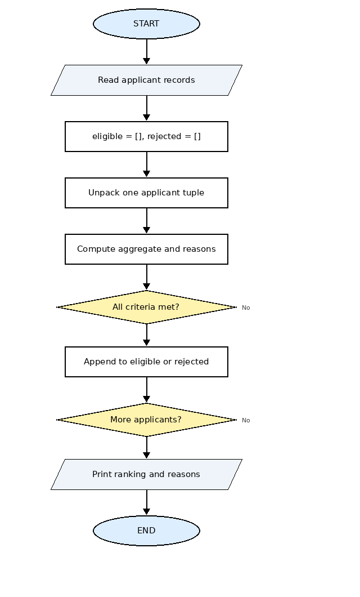
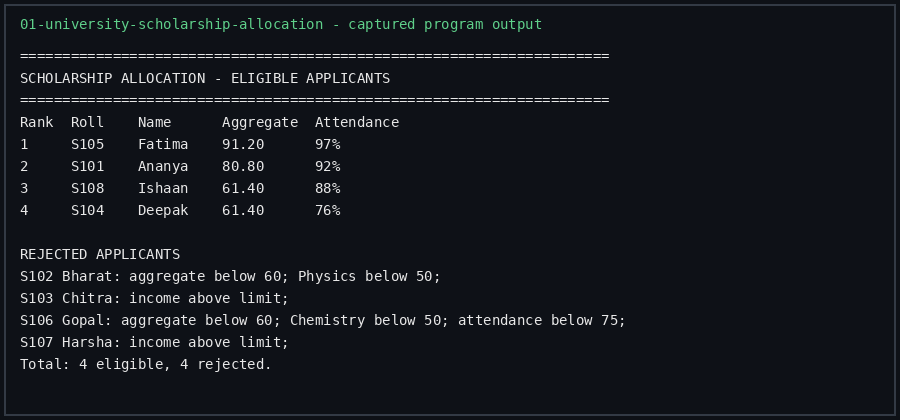

# Case Study 01 - University Scholarship Allocation

## Problem statement

Evaluate scholarship applicants using aggregate marks, subject-wise minimum scores, attendance and family income. Rank the eligible students and resolve ties using the stated rules.

## Objectives

Represent each applicant as a tuple, check every eligibility condition, collect the reasons for rejection, and produce a deterministic ranked list.

## Assumptions

Five subjects, each out of 100; aggregate is the arithmetic mean. Minimum aggregate 60, minimum subject mark 50, minimum attendance 75% and maximum family income Rs 5,00,000. Ties are resolved by higher attendance, then lower income, then roll number. All records are hypothetical.

## Algorithm

1. Start and set the four policy limits.
2. Store all applicants as tuples in a list.
3. Take one applicant and unpack the tuple.
4. Add the five marks and divide by 5 to get the aggregate.
5. Add a reason for every failed condition.
6. Put the applicant in the eligible or rejected list.
7. Repeat steps 3 to 6 for all applicants.
8. Insert eligible records into a ranked list using the tie rule.
9. Print the ranked list, the rejection reasons and the totals.
10. Stop.

## Flowchart



## Pseudocode

```
BEGIN SCHOLARSHIP
  SET limits: aggregate 60, subject 50, attendance 75, income 500000
  FOR each applicant DO
    UNPACK roll, name, marks, attendance, income
    aggregate = SUM(marks) / 5
    reasons = empty list
    IF aggregate < 60 THEN ADD reason
    FOR each mark DO IF mark < 50 THEN ADD reason
    IF attendance < 75 OR income > 500000 THEN ADD reason
    IF reasons is empty THEN ADD to eligible ELSE ADD to rejected
  END FOR
  INSERT each eligible record in rank order
  PRINT ranked list and rejected applicants
END
```

## Python source code

```python
"""
Case Study 1: University Scholarship Allocation
Only basic Python: variables, operators, loops, conditionals, lists,
tuples and tuple unpacking.
"""

MIN_AGGREGATE = 60.0
MIN_SUBJECT = 50
MIN_ATTENDANCE = 75.0
MAX_INCOME = 500000
SUBJECTS = ["Maths", "Physics", "Chemistry", "English", "Computer"]

# Each applicant is a tuple: (roll, name, marks, attendance, income)
APPLICANTS = [
    ("S101", "Ananya", [82, 76, 90, 71, 85], 92, 320000),
    ("S102", "Bharat", [55, 48, 62, 70, 58], 78, 480000),
    ("S103", "Chitra", [74, 69, 71, 66, 80], 84, 610000),
    ("S104", "Deepak", [61, 57, 64, 59, 66], 76, 495000),
    ("S105", "Fatima", [91, 88, 94, 87, 96], 97, 250000),
    ("S106", "Gopal",  [58, 52, 49, 63, 55], 71, 300000),
    ("S107", "Harsha", [77, 72, 68, 74, 70], 80, 540000),
    ("S108", "Ishaan", [64, 58, 66, 60, 59], 88, 410000),
]


def evaluate(applicant):
    roll, name, marks, attendance, income = applicant
    total = 0
    for mark in marks:
        total = total + mark
    aggregate = total / len(marks)
    reasons = []
    if aggregate < MIN_AGGREGATE:
        reasons.append("aggregate below 60")
    for i in range(len(marks)):
        if marks[i] < MIN_SUBJECT:
            reasons.append(SUBJECTS[i] + " below 50")
    if attendance < MIN_ATTENDANCE:
        reasons.append("attendance below 75")
    if income > MAX_INCOME:
        reasons.append("income above limit")
    return (len(reasons) == 0), aggregate, reasons


def comes_first(a, b):
    """Tie rule: aggregate, attendance, lower income, then roll number."""
    if a[2] != b[2]:
        return a[2] > b[2]
    if a[3] != b[3]:
        return a[3] > b[3]
    if a[4] != b[4]:
        return a[4] < b[4]
    return a[0] < b[0]


def rank_applicants(eligible):
    ranked = []
    for record in eligible:
        position = len(ranked)
        for i in range(len(ranked)):
            if comes_first(record, ranked[i]):
                position = i
                break
        ranked.insert(position, record)
    return ranked


def main():
    eligible = []
    rejected = []
    for applicant in APPLICANTS:
        roll, name, marks, attendance, income = applicant
        ok, aggregate, reasons = evaluate(applicant)
        if ok:
            eligible.append((roll, name, round(aggregate, 2), attendance, income))
        else:
            rejected.append((roll, name, reasons))

    ranked = rank_applicants(eligible)
    print("=" * 70)
    print("SCHOLARSHIP ALLOCATION - ELIGIBLE APPLICANTS")
    print("=" * 70)
    print("%-5s %-7s %-9s %-10s %-10s" % ("Rank", "Roll", "Name", "Aggregate", "Attendance"))
    for i in range(len(ranked)):
        roll, name, aggregate, attendance, income = ranked[i]
        print("%-5d %-7s %-9s %-10.2f %-10s" %
              (i + 1, roll, name, aggregate, str(attendance) + "%"))

    print("\nREJECTED APPLICANTS")
    for roll, name, reasons in rejected:
        line = roll + " " + name + ": "
        for reason in reasons:
            line = line + reason + "; "
        print(line)
    print("Total: %d eligible, %d rejected." % (len(ranked), len(rejected)))


if __name__ == "__main__":
    main()
```

## Test cases

1. S101 is eligible - PASS
2. S101 aggregate is 80.8 - PASS
3. S102 is rejected - PASS
4. S102 has two reasons - PASS
5. S103 rejected on income - PASS
6. S106 rejected on attendance - PASS
7. S105 has the best aggregate - PASS
8. tie broken by attendance - PASS
9. 4 eligible applicants - PASS
10. 4 rejected applicants - PASS

10/10 tests passed. (see `test_cases.py`).

## Output screenshot



Captured output: `output.txt`.

## Conclusion

The program checks all four criteria, explains each rejection and ranks eligible students without ambiguity. The 61.40 tie is correctly settled by attendance. Only loops, conditionals, lists, tuples and unpacking were used.
