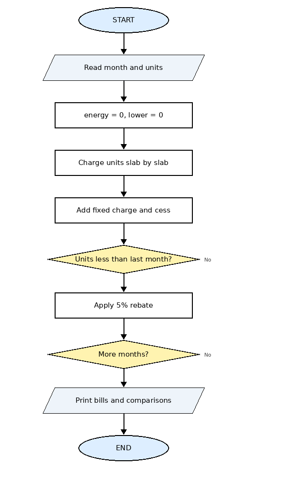
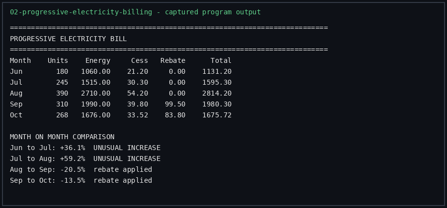

# Case Study 02 - Progressive Electricity Billing

## Problem statement

Calculate household electricity bills using consumption slabs, fixed charge, surcharge and rebate. Compare consecutive months and identify unusual increases.

## Objectives

Apply slab rates progressively with a loop, add fixed charge and cess, allow a rebate when consumption falls, and flag month-on-month jumps above 30%.

## Assumptions

Slabs are 0-100 at Rs 5, 101-300 at Rs 7, 301-500 at Rs 9 and above 500 at Rs 12 per unit. Fixed charge is Rs 50, cess is 2% of energy charge, rebate is 5% of energy charge when units decrease, and a rise above 30% is unusual.

## Algorithm

1. Start and define the four slabs and the charges.
2. Store the six month records as tuples.
3. Take the next month's units.
4. For every slab, charge only the units falling in that slab.
5. Add fixed charge and 2% cess.
6. Give 5% rebate if units are less than the previous month.
7. Store the bill and repeat for all months.
8. Compare each month with the previous month.
9. Print bills and unusual increases, then stop.

## Flowchart



## Pseudocode

```
BEGIN ELECTRICITY
  SLABS = (100,5), (300,7), (500,9), (large,12)
  FOR each (month, units) DO
    remaining = units, lower = 0, energy = 0
    FOR each (upper, rate) DO
      in_slab = MIN(remaining, upper - lower)
      energy = energy + in_slab * rate
      remaining = remaining - in_slab
    END FOR
    cess = energy * 0.02
    IF units < previous THEN rebate = energy * 0.05
    total = energy + 50 + cess - rebate
    IF change > 0.30 THEN PRINT unusual increase
  END FOR
END
```

## Python source code

```python
"""
Case Study 2: Progressive Electricity Billing
Slab arithmetic with loops; fixed charge, cess and rebate with conditionals.
"""

SLABS = [(100, 5.0), (300, 7.0), (500, 9.0), (10000000, 12.0)]
FIXED_CHARGE = 50.0
CESS_RATE = 0.02
REBATE_RATE = 0.05
UNUSUAL_LIMIT = 0.30

# Month records are tuples: (month name, units consumed)
MONTHS = [("Jun", 180), ("Jul", 245), ("Aug", 390), ("Sep", 310), ("Oct", 268)]


def slab_charge(units):
    charge = 0.0
    lower = 0
    remaining = units
    for upper, rate in SLABS:
        if remaining <= 0:
            break
        in_slab = remaining
        if upper - lower < in_slab:
            in_slab = upper - lower
        charge = charge + in_slab * rate
        remaining = remaining - in_slab
        lower = upper
    return charge


def compute_bill(units, previous_units):
    energy = slab_charge(units)
    cess = energy * CESS_RATE
    rebate = 0.0
    if previous_units != -1 and units < previous_units:
        rebate = energy * REBATE_RATE
    total = energy + FIXED_CHARGE + cess - rebate
    return (units, round(energy, 2), round(cess, 2), round(rebate, 2), round(total, 2))


def main():
    bills = []
    previous = -1
    for month, units in MONTHS:
        bills.append((month, compute_bill(units, previous)))
        previous = units

    print("=" * 76)
    print("PROGRESSIVE ELECTRICITY BILL")
    print("=" * 76)
    print("%-6s %7s %9s %8s %8s %10s" %
          ("Month", "Units", "Energy", "Cess", "Rebate", "Total"))
    for month, bill in bills:
        print("%-6s %7d %9.2f %8.2f %8.2f %10.2f" %
              (month, bill[0], bill[1], bill[2], bill[3], bill[4]))

    print("\nMONTH ON MONTH COMPARISON")
    for i in range(1, len(bills)):
        old_month, old = bills[i - 1]
        new_month, new = bills[i]
        change = (new[0] - old[0]) / old[0]
        note = ""
        if change > UNUSUAL_LIMIT:
            note = "  UNUSUAL INCREASE"
        elif change < 0:
            note = "  rebate applied"
        print("%s to %s: %+.1f%%%s" %
              (old_month, new_month, change * 100, note))


if __name__ == "__main__":
    main()
```

## Test cases

1. 100 units cost Rs 500 - PASS
2. 300 units cost Rs 1900 - PASS
3. 500 units cost Rs 3700 - PASS
4. 550 units cost Rs 4300 - PASS
5. 0 units cost 0 - PASS
6. fixed charge included - PASS
7. cess is 2 percent - PASS
8. rebate on decrease - PASS
9. no rebate on increase - PASS
10. five months are supplied - PASS

10/10 tests passed. (see `test_cases.py`).

## Output screenshot



Captured output: `output.txt`.

## Conclusion

Progressive charging, cess, rebate and month comparison work together. The tariff table is separate from the logic, so rates can be changed easily.
