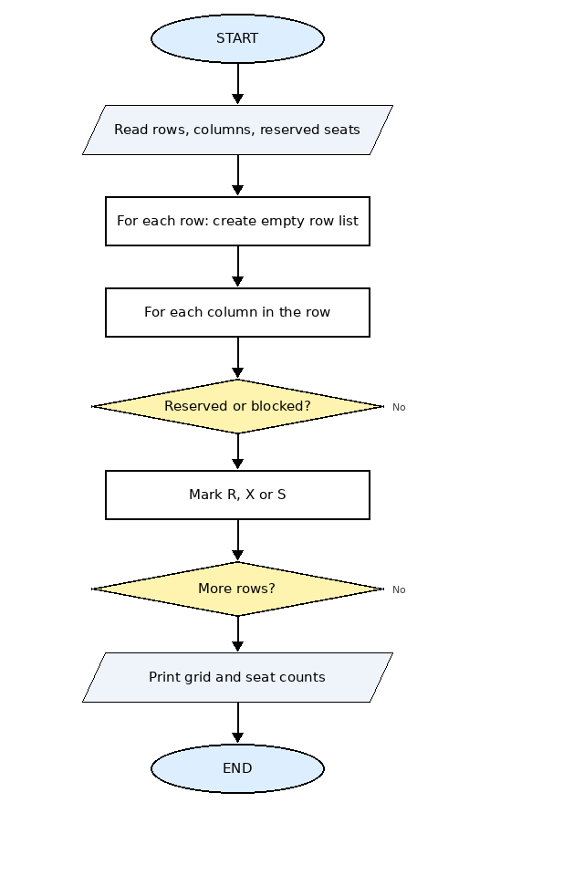
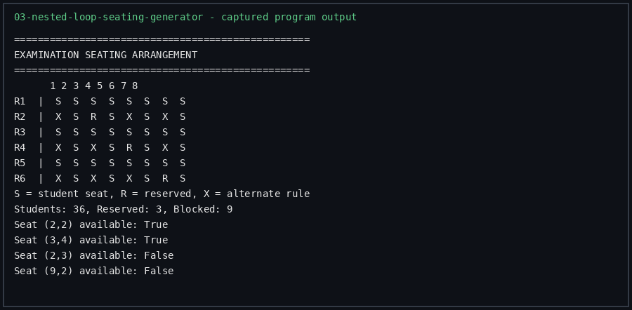

# Case Study 03 - Nested Loop Examination Seating Generator

## Problem statement

Generate a classroom seating plan with row and column labels, reserved seats and alternate-seat restrictions, and check whether a requested seat is free.

## Objectives

Build a grid with nested lists and nested loops, mark reserved and blocked positions, count each seat type and validate seat requests.

## Assumptions

The classroom has 6 rows and 8 columns. Reserved seats are (2,3), (4,5) and (6,7). In even-numbered rows odd columns are blocked, except reserved seats. S means student seat, R means reserved and X means blocked.

## Algorithm

1. Start; set rows, columns and the reserved tuple list.
2. For each row, create an empty list.
3. For each column, decide the seat type using conditions.
4. Append R, X or S to the current row.
5. Add the row to the seating grid.
6. Count S, R and X seats with nested loops.
7. Check requested seats using row and column bounds.
8. Print the labelled grid, counts and availability, then stop.

## Flowchart



## Pseudocode

```
BEGIN SEATING
  FOR each row FROM 1 TO 6 DO
    row_list = empty list
    FOR each column FROM 1 TO 8 DO
      IF (row,column) IN reserved THEN ADD R
      ELSE IF row even AND column odd THEN ADD X
      ELSE ADD S
    END FOR
    APPEND row_list TO grid
  END FOR
  COUNT S, R and X using two nested loops
  PRINT grid and availability of sample seats
END
```

## Python source code

```python
"""
Case Study 3: Nested Loop Examination Seating Generator
Nested lists, nested loops, tuples and conditional statements.
"""

ROWS = 6
COLS = 8
RESERVED = [(2, 3), (4, 5), (6, 7)]   # (row, column), both start at 1


def build_seating(rows, cols, reserved):
    grid = []
    for r in range(1, rows + 1):
        row_seats = []
        for c in range(1, cols + 1):
            seat = (r, c)
            if seat in reserved:
                row_seats.append("R")
            elif r % 2 == 0 and c % 2 == 1:
                row_seats.append("X")
            else:
                row_seats.append("S")
        grid.append(row_seats)
    return grid


def count_seats(grid, symbol):
    total = 0
    for row in grid:
        for seat in row:
            if seat == symbol:
                total = total + 1
    return total


def is_seat_free(grid, row, column):
    if row < 1 or row > len(grid):
        return False
    if column < 1 or column > len(grid[0]):
        return False
    return grid[row - 1][column - 1] == "S"


def print_seating(grid):
    header = "      "
    for c in range(1, len(grid[0]) + 1):
        header = header + str(c) + " "
    print(header)
    for r in range(len(grid)):
        line = "R" + str(r + 1) + "  |  "
        for seat in grid[r]:
            line = line + seat + "  "
        print(line)
    print("S = student seat, R = reserved, X = alternate rule")


def main():
    grid = build_seating(ROWS, COLS, RESERVED)
    print("=" * 50)
    print("EXAMINATION SEATING ARRANGEMENT")
    print("=" * 50)
    print_seating(grid)
    print("Students: %d, Reserved: %d, Blocked: %d" %
          (count_seats(grid, "S"), count_seats(grid, "R"), count_seats(grid, "X")))
    for row, column in [(2, 2), (3, 4), (2, 3), (9, 2)]:
        print("Seat (%d,%d) available: %s" % (row, column, is_seat_free(grid, row, column)))


if __name__ == "__main__":
    main()
```

## Test cases

1. 6 rows in the grid - PASS
2. 8 columns in every row - PASS
3. (2,3) is reserved - PASS
4. (4,5) is reserved - PASS
5. (2,1) blocked by alternate rule - PASS
6. (2,2) is a student seat - PASS
7. (4,5) reserved although odd column - PASS
8. free seat accepted - PASS
9. reserved seat rejected - PASS
10. out of range seat rejected - PASS
11. student seats counted - PASS
12. all seats accounted for - PASS

12/12 tests passed. (see `test_cases.py`).

## Output screenshot



Captured output: `output.txt`.

## Conclusion

Nested loops build and inspect the whole grid. Reserved seats override the alternate rule, and the final count accounts for all 48 positions.
