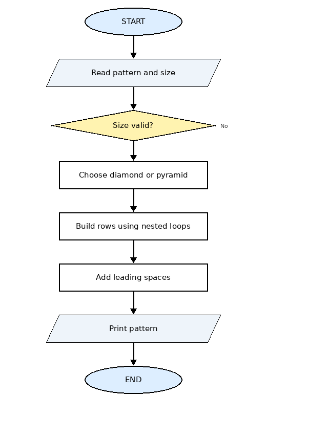
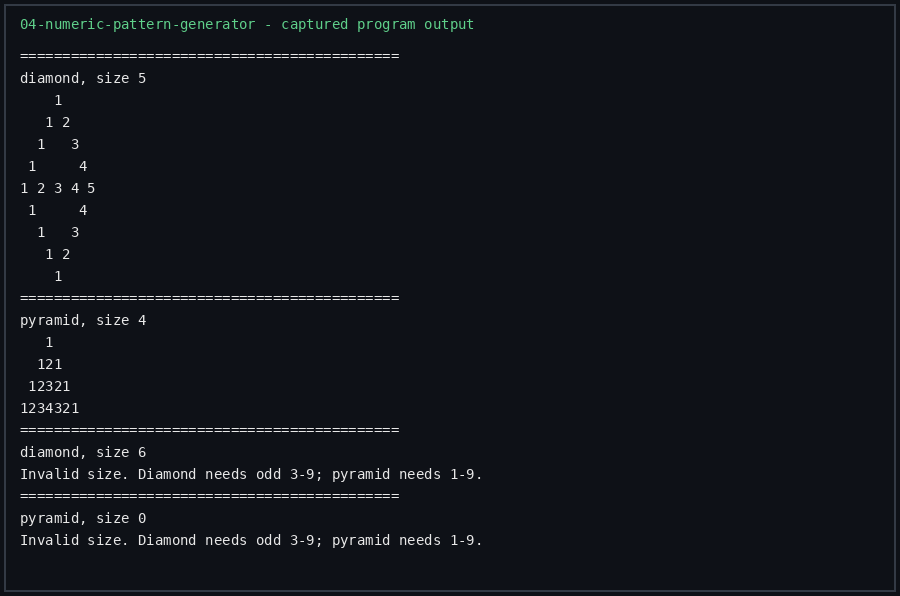

# Case Study 04 - Advanced Numeric Pattern Generator

## Problem statement

Produce a hollow diamond or a symmetric number pyramid for a given size, with validation of invalid dimensions and carefully aligned output.

## Objectives

Use nested loops to place numbers and spaces, validate dimensions, and keep the output aligned for both patterns.

## Assumptions

A diamond needs an odd size from 3 to 9. A pyramid needs a size from 1 to 9. Interior positions of the hollow diamond contain spaces; the middle row shows all numbers. The pyramid row n contains 1 to n and back to 1.

## Algorithm

1. Start and read the pattern name and size.
2. Check whether the size is valid for that pattern.
3. For the diamond, build the width sequence up and down.
4. Place numbers at the edges and spaces in the interior.
5. For the pyramid, build each row from 1 up to the level and down.
6. Add leading spaces to centre each row.
7. Print the lines or an invalid-size message, then stop.

## Flowchart



## Pseudocode

```
BEGIN PATTERN
  IF pattern = diamond AND size is odd AND 3 <= size <= 9 THEN
    FOR each width in 1..size..1 DO
      place numbers at first and last position, spaces inside
      print leading spaces then the row
  ELSE IF pattern = pyramid AND 1 <= size <= 9 THEN
    FOR level = 1 TO size DO
      row = 1..level..1
      print leading spaces then row
  ELSE PRINT invalid size
END
```

## Python source code

```python
"""
Case Study 4: Advanced Numeric Pattern Generator
Nested loops, strings and validation of dimensions.
"""


def valid_size(pattern, size):
    if pattern == "diamond":
        return size >= 3 and size <= 9 and size % 2 == 1
    if pattern == "pyramid":
        return size >= 1 and size <= 9
    return False


def diamond_lines(size):
    lines = []
    widths = []
    for k in range(1, size + 1):
        widths.append(k)
    for k in range(size - 1, 0, -1):
        widths.append(k)
    for width in widths:
        parts = []
        for j in range(1, width + 1):
            if j == 1 or j == width or width == size:
                parts.append(str(j))
            else:
                parts.append(" ")
        lines.append(" " * (size - width) + " ".join(parts))
    return lines


def pyramid_lines(size):
    lines = []
    for level in range(1, size + 1):
        numbers = ""
        for j in range(1, level + 1):
            numbers = numbers + str(j)
        for j in range(level - 1, 0, -1):
            numbers = numbers + str(j)
        lines.append(" " * (size - level) + numbers)
    return lines


def main():
    samples = [("diamond", 5), ("pyramid", 4), ("diamond", 6), ("pyramid", 0)]
    for pattern, size in samples:
        print("=" * 45)
        print("%s, size %d" % (pattern, size))
        if not valid_size(pattern, size):
            print("Invalid size. Diamond needs odd 3-9; pyramid needs 1-9.")
        else:
            if pattern == "diamond":
                lines = diamond_lines(size)
            else:
                lines = pyramid_lines(size)
            for line in lines:
                print(line)


if __name__ == "__main__":
    main()
```

## Test cases

1. diamond size 5 accepted - PASS
2. diamond height is 9 rows - PASS
3. centre row of diamond - PASS
4. top row of diamond - PASS
5. even diamond size rejected - PASS
6. diamond size 1 rejected - PASS
7. pyramid size 4 accepted - PASS
8. pyramid top row - PASS
9. pyramid last row - PASS
10. negative size rejected - PASS
11. unknown pattern rejected - PASS

11/11 tests passed. (see `test_cases.py`).

## Output screenshot



Captured output: `output.txt`.

## Conclusion

Validation prevents misaligned output. Nested loops and string concatenation are enough to generate both patterns without any graphics library.
