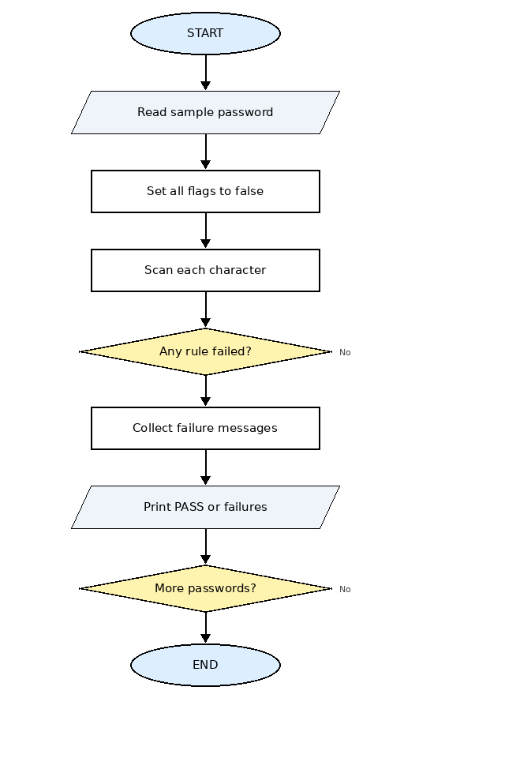
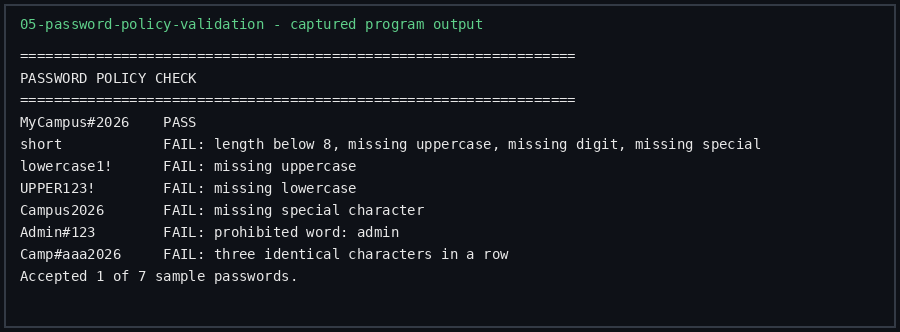

# Case Study 05 - Password Policy Validation Engine

## Problem statement

Check sample passwords against a policy and explain every rule that fails.

## Objectives

Scan each string for character categories, repeated characters and prohibited words, and report all failures at once.

## Assumptions

Minimum length 8; at least one uppercase, one lowercase, one digit and one character from !@#$; no three identical consecutive characters; no case-insensitive 'password' or 'admin' substring.

## Algorithm

1. Start and define the special characters and prohibited words.
2. Take the next password string.
3. Scan every character and set category flags.
4. Check length and the four category flags.
5. Scan triples of equal characters.
6. Check for prohibited words using lower case.
7. Print PASS or all failures, then stop.

## Flowchart



## Pseudocode

```
BEGIN PASSWORD CHECK
  FOR each password DO
    failures = empty list
    FOR each character DO
      IF uppercase/lowercase/digit/special THEN set flag
    END FOR
    IF length < 8 THEN ADD failure
    IF any flag is false THEN ADD failure
    FOR each triple DO IF all equal THEN ADD failure
    IF 'password' or 'admin' in lower(password) THEN ADD failure
    PRINT failures or PASS
  END FOR
END
```

## Python source code

```python
"""
Case Study 5: Password Policy Validation Engine
String scanning, loops and conditional checks.
"""

SPECIALS = "!@#$%"
MIN_LENGTH = 8
BAD_WORDS = ["password", "admin"]


def validate(password):
    failures = []
    upper = False
    lower = False
    digit = False
    special = False

    for ch in password:
        if "A" <= ch <= "Z":
            upper = True
        elif "a" <= ch <= "z":
            lower = True
        elif "0" <= ch <= "9":
            digit = True
        elif ch in SPECIALS:
            special = True

    if len(password) < MIN_LENGTH:
        failures.append("length below 8")
    if not upper:
        failures.append("missing uppercase")
    if not lower:
        failures.append("missing lowercase")
    if not digit:
        failures.append("missing digit")
    if not special:
        failures.append("missing special character")

    for i in range(len(password) - 2):
        if password[i] == password[i + 1] and password[i] == password[i + 2]:
            failures.append("three identical characters in a row")
            break

    small = password.lower()
    for word in BAD_WORDS:
        if word in small:
            failures.append("prohibited word: " + word)
    return failures


def main():
    samples = ["MyCampus#2026", "short", "lowercase1!", "UPPER123!",
               "Campus2026", "Admin#123", "Camp#aaa2026"]
    print("=" * 66)
    print("PASSWORD POLICY CHECK")
    print("=" * 66)
    accepted = 0
    for password in samples:
        failures = validate(password)
        if len(failures) == 0:
            accepted = accepted + 1
            print("%-16s PASS" % password)
        else:
            detail = ""
            for failure in failures:
                if detail != "":
                    detail = detail + ", "
                detail = detail + failure
            print("%-16s FAIL: %s" % (password, detail))
    print("Accepted %d of %d sample passwords." % (accepted, len(samples)))


if __name__ == "__main__":
    main()
```

## Test cases

1. valid password accepted - PASS
2. short password fails length - PASS
3. missing uppercase - PASS
4. missing digit - PASS
5. missing special - PASS
6. prohibited admin found - PASS
7. triple repeat found - PASS
8. abcabc has no triple repeat - PASS
9. two repeats are allowed - PASS
10. several failures together - PASS

10/10 tests passed. (see `test_cases.py`).

## Output screenshot



Captured output: `output.txt`.

## Conclusion

All violated rules are reported together instead of stopping at the first error. String scanning and conditionals are sufficient for the validation.
