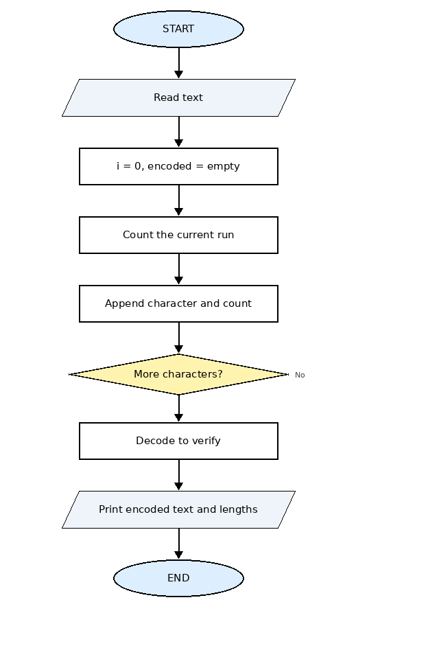
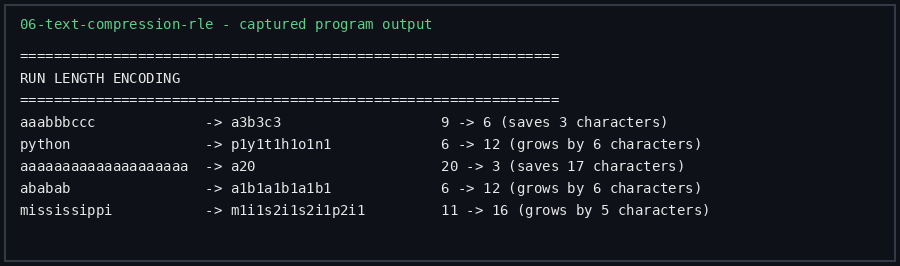

# Case Study 06 - Text Compression Using Character Runs

## Problem statement

Encode a string by grouping consecutive repeated characters and compare the original and encoded lengths, including cases where encoding is not useful.

## Objectives

Scan runs of characters, write each run as character plus count, decode the result to verify it, and decide whether the encoding saves space.

## Assumptions

A run is one or more identical consecutive characters; even a single character is written with count 1. Counts may have more than one digit. The test strings are hypothetical.

## Algorithm

1. Start and read a sample string.
2. Set the position to the first character.
3. Count how many following characters are the same.
4. Append the character and its count to the encoded string.
5. Move to the next different character and repeat.
6. Decode by reading a character and the following digits.
7. Compare original and encoded lengths, then stop.

## Flowchart



## Pseudocode

```
BEGIN RLE
  FOR each sample text DO
    i = 0, encoded = empty string
    WHILE i < length(text) DO
      char = text[i], count = 0
      WHILE text[i] = char DO count++, i++
      encoded = encoded + char + STRING(count)
    END WHILE
    decoded = read chars and digit counts from encoded
    PRINT encoded, original length, encoded length
  END FOR
END
```

## Python source code

```python
"""
Case Study 6: Text Compression Using Character Runs
Strings, loops, operators and lists of records.
"""

SAMPLES = ["aaabbbccc", "python", "aaaaaaaaaaaaaaaaaaaa", "ababab", "mississippi"]


def encode(text):
    result = ""
    i = 0
    while i < len(text):
        character = text[i]
        count = 0
        while i < len(text) and text[i] == character:
            count = count + 1
            i = i + 1
        result = result + character + str(count)
    return result


def decode(text):
    result = ""
    i = 0
    while i < len(text):
        character = text[i]
        i = i + 1
        digits = ""
        while i < len(text) and "0" <= text[i] <= "9":
            digits = digits + text[i]
            i = i + 1
        for j in range(int(digits)):
            result = result + character
    return result


def main():
    print("=" * 64)
    print("RUN LENGTH ENCODING")
    print("=" * 64)
    for text in SAMPLES:
        coded = encode(text)
        change = len(coded) - len(text)
        if change < 0:
            note = "saves %d characters" % (-change)
        elif change > 0:
            note = "grows by %d characters" % change
        else:
            note = "same length"
        print("%-21s -> %-24s %d -> %d (%s)" %
              (text, coded, len(text), len(coded), note))
        if decode(coded) != text:
            print("Decoding check failed!")


if __name__ == "__main__":
    main()
```

## Test cases

1. three runs encoded - PASS
2. single letters get count 1 - PASS
3. 20 repeats give two digits - PASS
4. empty string - PASS
5. alternating letters - PASS
6. 20 a chars shrink - PASS
7. python grows - PASS
8. aabb has equal length - PASS
9. mississippi encoded - PASS
10. round trip for all samples - PASS

10/10 tests passed. (see `test_cases.py`).

## Output screenshot



Captured output: `output.txt`.

## Conclusion

Runs of repeated characters compress well, while alternating characters grow after encoding. The decode check confirms that no information is lost.
