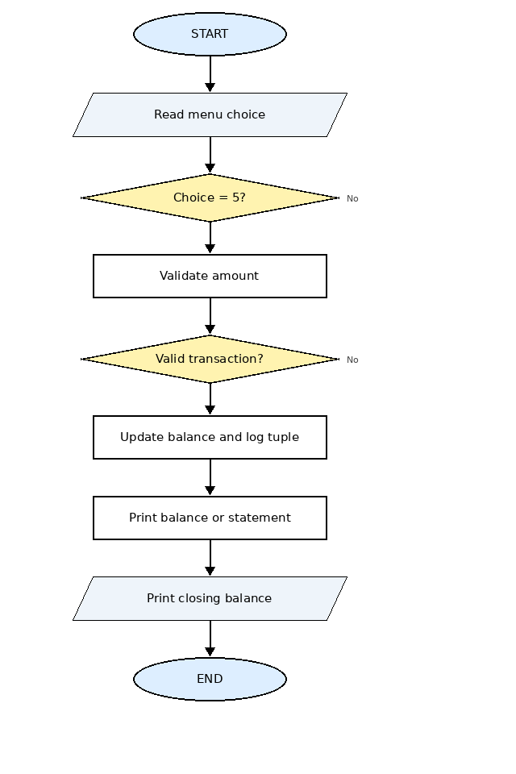
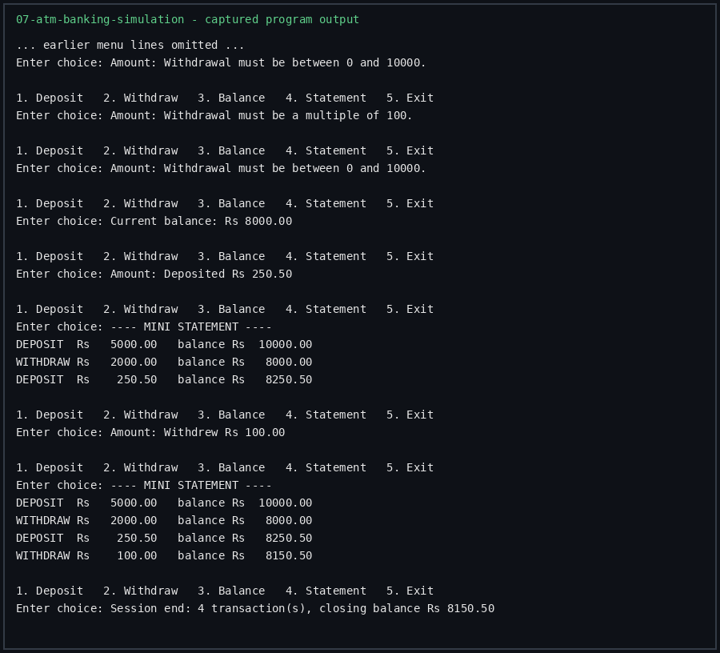

# Case Study 07 - ATM Menu-Driven Banking Simulation

## Problem statement

Simulate repeated deposit, withdrawal, balance and statement operations with validation and a transaction summary.

## Objectives

Use a menu loop, validate amounts, maintain a running balance and store each successful transaction as a tuple.

## Assumptions

Opening balance Rs 5000. Deposits must be positive and at most Rs 1,00,000. Withdrawals must be multiples of Rs 100, at most Rs 10,000, and must leave a minimum balance of Rs 1000. Sample input is in demo_input.txt.

## Algorithm

1. Start with balance 5000 and an empty transaction list.
2. Display the menu and read a choice.
3. For deposit, validate the amount and add it to the balance.
4. For withdrawal, validate amount, multiple and minimum balance.
5. For balance, print the current balance.
6. For statement, print every logged transaction.
7. Repeat until choice 5 is entered.
8. Print the closing summary and stop.

## Flowchart



## Pseudocode

```
BEGIN ATM
  balance = 5000, log = empty list
  REPEAT
    PRINT menu and READ choice
    IF choice = 1 THEN validate deposit and update balance
    ELSE IF choice = 2 THEN validate withdrawal and update balance
    ELSE IF choice = 3 THEN PRINT balance
    ELSE IF choice = 4 THEN PRINT log
  UNTIL choice = 5
  PRINT number of transactions and closing balance
END
```

## Python source code

```python
"""
Case Study 7: ATM Menu-Driven Banking Simulation
Loops, conditionals, tuples and a transaction list.
"""

MIN_BALANCE = 1000.0
MAX_DEPOSIT = 100000.0
MAX_WITHDRAWAL = 10000.0

# Log entries are tuples: (transaction type, amount, balance after it)


def deposit(balance, amount, log):
    if amount <= 0 or amount > MAX_DEPOSIT:
        return balance, "Deposit must be between 0 and 100000."
    balance = balance + amount
    log.append(("DEPOSIT", amount, balance))
    return balance, "Deposited Rs %.2f" % amount


def withdraw(balance, amount, log):
    if amount <= 0 or amount > MAX_WITHDRAWAL:
        return balance, "Withdrawal must be between 0 and 10000."
    if amount % 100 != 0:
        return balance, "Withdrawal must be a multiple of 100."
    if balance - amount < MIN_BALANCE:
        return balance, "Minimum balance of Rs 1000 must be kept."
    balance = balance - amount
    log.append(("WITHDRAW", amount, balance))
    return balance, "Withdrew Rs %.2f" % amount


def read_amount(prompt):
    value = input(prompt)
    try:
        amount = float(value)
    except ValueError:
        return -1.0
    return amount


def main():
    balance = 5000.0
    log = []
    while True:
        print("\n1. Deposit   2. Withdraw   3. Balance   4. Statement   5. Exit")
        choice = input("Enter choice: ")
        if choice == "1":
            balance, message = deposit(balance, read_amount("Amount: "), log)
            print(message)
        elif choice == "2":
            balance, message = withdraw(balance, read_amount("Amount: "), log)
            print(message)
        elif choice == "3":
            print("Current balance: Rs %.2f" % balance)
        elif choice == "4":
            print("---- MINI STATEMENT ----")
            for kind, amount, after in log:
                print("%-8s Rs %9.2f   balance Rs %9.2f" % (kind, amount, after))
        elif choice == "5":
            break
        else:
            print("Please choose 1 to 5.")
    print("Session end: %d transaction(s), closing balance Rs %.2f" %
          (len(log), balance))


if __name__ == "__main__":
    main()
```

## Test cases

1. deposit accepted - PASS
2. deposit is logged - PASS
3. negative deposit rejected - PASS
4. large deposit rejected - PASS
5. valid withdrawal - PASS
6. non multiple of 100 rejected - PASS
7. large withdrawal rejected - PASS
8. minimum balance enforced - PASS
9. exact minimum allowed - PASS
10. two successful log entries - PASS

10/10 tests passed. (see `test_cases.py`).

## Output screenshot



Captured output: `output.txt`.

## Conclusion

Invalid transactions do not change the balance or the log. A tuple list keeps the mini statement simple and easy to print.
