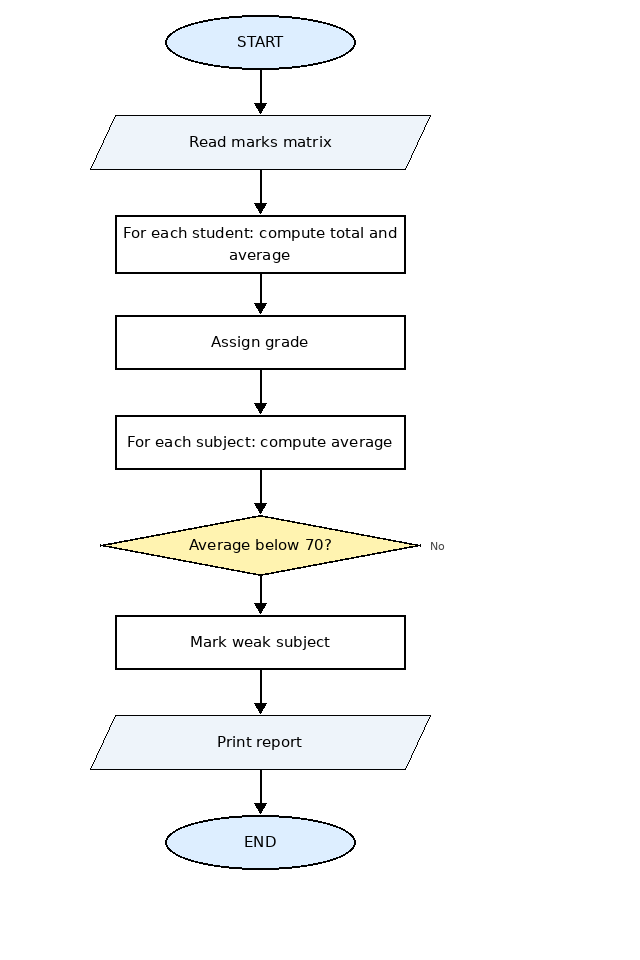
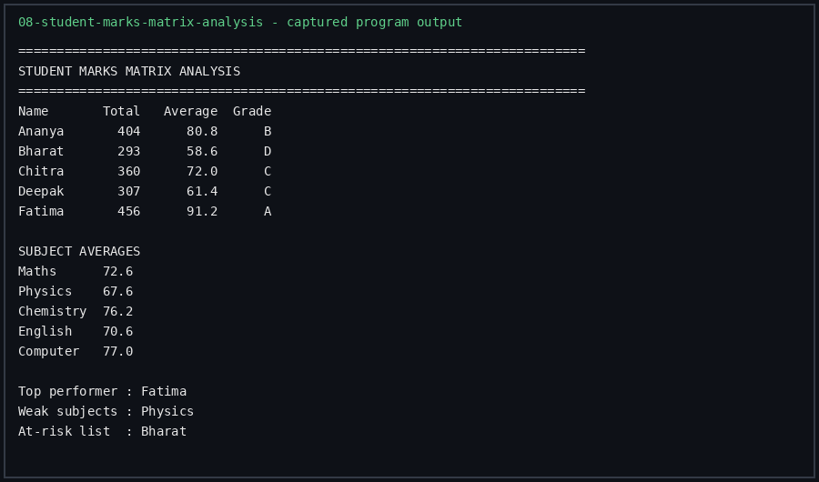

# Case Study 08 - Student Marks Matrix Analysis

## Problem statement

Analyse a matrix of marks for several students and subjects, calculate row and column statistics, find the top performer and detect weak subjects.

## Objectives

Store marks in nested lists, compute totals and averages with loops, assign grades with conditions and list students at risk.

## Assumptions

Five students and five subjects, marks from 0 to 100. A subject average below 70 is weak; a mark below 50 puts a student at risk. Grades: A at 85 and above, B at 75, C at 60, D at 40, otherwise F.

## Algorithm

1. Start and store student names and the marks matrix.
2. For each student, add the marks and find the total and average.
3. Assign the grade using the average.
4. For each subject, calculate the column average.
5. Find the student with the highest total by comparison.
6. List subjects whose average is below 70.
7. List students having any mark below 50.
8. Print the tables and lists, then stop.

## Flowchart



## Pseudocode

```
BEGIN MARKS ANALYSIS
  FOR each student row DO
    total = sum of marks, average = total / 5
    grade = A/B/C/D/F by average
  END FOR
  FOR each subject column DO
    average = sum of column / number of students
    IF average < 70 THEN ADD to weak list
  END FOR
  FIND student with highest total
  PRINT student table, subject averages and weak subjects
END
```

## Python source code

```python
"""
Case Study 8: Student Marks Matrix Analysis
Nested lists, loops, tuples and conditional statements.
"""

NAMES = ("Ananya", "Bharat", "Chitra", "Deepak", "Fatima")
SUBJECTS = ("Maths", "Physics", "Chemistry", "English", "Computer")
MARKS = [
    [82, 76, 90, 71, 85],
    [55, 48, 62, 70, 58],
    [74, 69, 71, 66, 80],
    [61, 57, 64, 59, 66],
    [91, 88, 94, 87, 96],
]
WEAK_AVERAGE = 70.0
PASS_MARK = 50


def row_total(row):
    total = 0
    for mark in row:
        total = total + mark
    return total


def row_average(row):
    return row_total(row) / len(row)


def column_average(matrix, column):
    total = 0
    for row in matrix:
        total = total + row[column]
    return total / len(matrix)


def grade(average):
    if average >= 85:
        return "A"
    elif average >= 75:
        return "B"
    elif average >= 60:
        return "C"
    elif average >= 40:
        return "D"
    return "F"


def top_student(matrix, names):
    best = 0
    for i in range(1, len(matrix)):
        if row_total(matrix[i]) > row_total(matrix[best]):
            best = i
    return names[best]


def weak_subjects(matrix, subjects):
    weak = []
    for c in range(len(subjects)):
        if column_average(matrix, c) < WEAK_AVERAGE:
            weak.append(subjects[c])
    return weak


def at_risk(matrix, names):
    risk = []
    for i in range(len(matrix)):
        for mark in matrix[i]:
            if mark < PASS_MARK:
                risk.append(names[i])
                break
    return risk


def main():
    print("=" * 74)
    print("STUDENT MARKS MATRIX ANALYSIS")
    print("=" * 74)
    print("%-9s %6s %9s %6s" % ("Name", "Total", "Average", "Grade"))
    for i in range(len(MARKS)):
        average = row_average(MARKS[i])
        print("%-9s %6d %9.1f %6s" %
              (NAMES[i], row_total(MARKS[i]), average, grade(average)))
    print("\nSUBJECT AVERAGES")
    for c in range(len(SUBJECTS)):
        print("%-10s %.1f" % (SUBJECTS[c], column_average(MARKS, c)))
    print("\nTop performer : " + top_student(MARKS, NAMES))
    print("Weak subjects : " + ", ".join(weak_subjects(MARKS, SUBJECTS)))
    print("At-risk list  : " + ", ".join(at_risk(MARKS, NAMES)))


if __name__ == "__main__":
    main()
```

## Test cases

1. matrix has 5 students - PASS
2. every row has 5 subjects - PASS
3. Ananya total - PASS
4. Fatima total - PASS
5. Maths average - PASS
6. Physics average - PASS
7. Physics is weak - PASS
8. top performer - PASS
9. only Bharat at risk - PASS
10. grade A - PASS
11. grade B - PASS
12. grade C - PASS
13. grade D - PASS
14. grade F - PASS
15. all marks within 0 to 100 - PASS

15/15 tests passed. (see `test_cases.py`).

## Output screenshot



Captured output: `output.txt`.

## Conclusion

Nested lists make row and column calculations straightforward. Physics is the only weak subject and Bharat is the only student below 50 in a subject.
