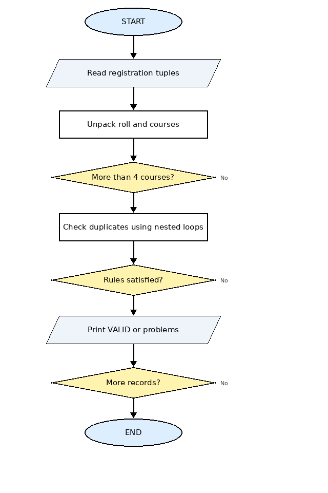
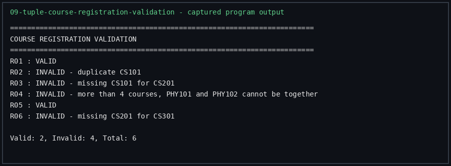

# Case Study 09 - Tuple-Based Course Registration Validation

## Problem statement

Validate course registrations stored as tuples, identify duplicate courses, missing prerequisites, exclusive pairs and over-limit selections.

## Objectives

Use tuples and tuple unpacking, compare course codes with nested loops, and report every rule violated by a registration.

## Assumptions

Maximum four courses per student. CS201 needs CS101 and CS301 needs CS201. PHY101 and PHY102 cannot be selected together. All records are hypothetical.

## Algorithm

1. Start and store registrations as a tuple of tuples.
2. Take one registration and unpack roll and courses.
3. If courses exceed four, add an over-limit reason.
4. Compare every pair of courses for duplicates.
5. Check each prerequisite pair.
6. Check the exclusive pair.
7. Print VALID or all problems, then stop.

## Flowchart



## Pseudocode

```
BEGIN COURSE VALIDATION
  FOR each (roll, courses) DO
    problems = empty list
    IF length(courses) > 4 THEN ADD problem
    FOR each pair of courses DO IF equal THEN ADD problem
    IF CS201 in courses AND CS101 not in courses THEN ADD problem
    IF CS301 in courses AND CS201 not in courses THEN ADD problem
    IF PHY101 and PHY102 both present THEN ADD problem
    PRINT roll with problems or VALID
  END FOR
END
```

## Python source code

```python
"""
Case Study 9: Tuple-Based Course Registration Validation
Tuples, tuple unpacking, loops, strings and conditionals.
"""

MAX_COURSES = 4
PREREQUISITES = (("CS201", "CS101"), ("CS301", "CS201"))
EXCLUSIVE_PAIRS = (("PHY101", "PHY102"),)

# A record is (roll number, tuple of course codes)
REGISTRATIONS = (
    ("R01", ("CS101", "MATH101", "PHY101", "ENG101")),
    ("R02", ("CS101", "CS201", "CS101", "MATH101")),
    ("R03", ("CS201", "MATH101")),
    ("R04", ("PHY101", "PHY102", "CS101", "ENG101", "MATH101")),
    ("R05", ("CS101", "CS201", "CS301", "MATH101")),
    ("R06", ("CS301", "MATH101")),
)


def validate(record):
    roll, courses = record
    problems = []
    if len(courses) > MAX_COURSES:
        problems.append("more than 4 courses")
    for i in range(len(courses)):
        for j in range(i + 1, len(courses)):
            if courses[i] == courses[j]:
                problems.append("duplicate " + courses[i])
    for course, needed in PREREQUISITES:
        if course in courses and needed not in courses:
            problems.append("missing " + needed + " for " + course)
    for first, second in EXCLUSIVE_PAIRS:
        if first in courses and second in courses:
            problems.append(first + " and " + second + " cannot be together")
    return problems


def main():
    valid_count = 0
    print("=" * 72)
    print("COURSE REGISTRATION VALIDATION")
    print("=" * 72)
    for record in REGISTRATIONS:
        roll, courses = record
        problems = validate(record)
        if len(problems) == 0:
            valid_count = valid_count + 1
            print(roll + " : VALID")
        else:
            detail = ""
            for problem in problems:
                if detail != "":
                    detail = detail + ", "
                detail = detail + problem
            print(roll + " : INVALID - " + detail)
    print("\nValid: %d, Invalid: %d, Total: %d" %
          (valid_count, len(REGISTRATIONS) - valid_count, len(REGISTRATIONS)))


if __name__ == "__main__":
    main()
```

## Test cases

1. R01 is valid - PASS
2. R02 duplicate CS101 - PASS
3. R03 missing prerequisite - PASS
4. R04 exclusive pair - PASS
5. R04 exceeds course limit - PASS
6. R04 has no duplicate course - PASS
7. R05 is valid - PASS
8. R06 missing CS201 - PASS
9. outer record is a tuple - PASS
10. inner courses are tuples - PASS
11. 2 valid and 4 invalid - PASS

11/11 tests passed. (see `test_cases.py`).

## Output screenshot



Captured output: `output.txt`.

## Conclusion

Tuple records stay unchanged during validation. Nested loops find duplicates and the rule list makes it easy to add more conditions later.
