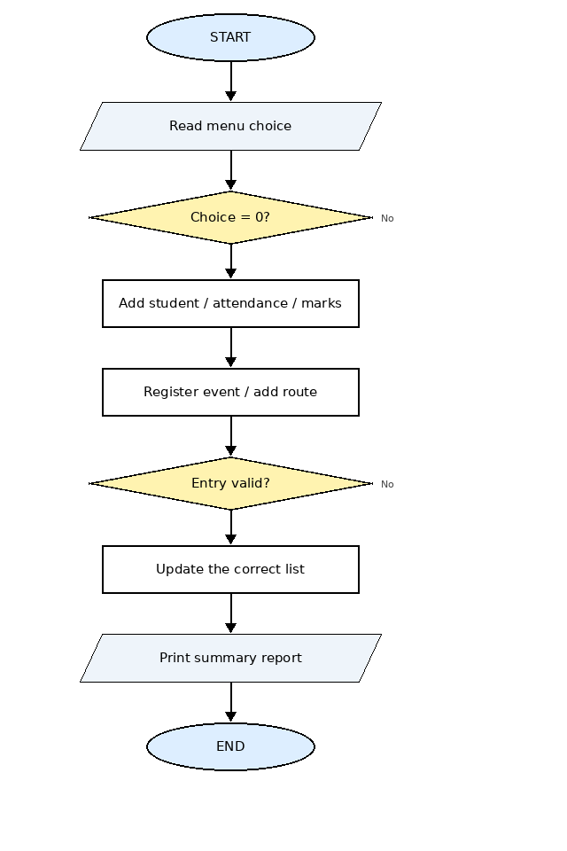
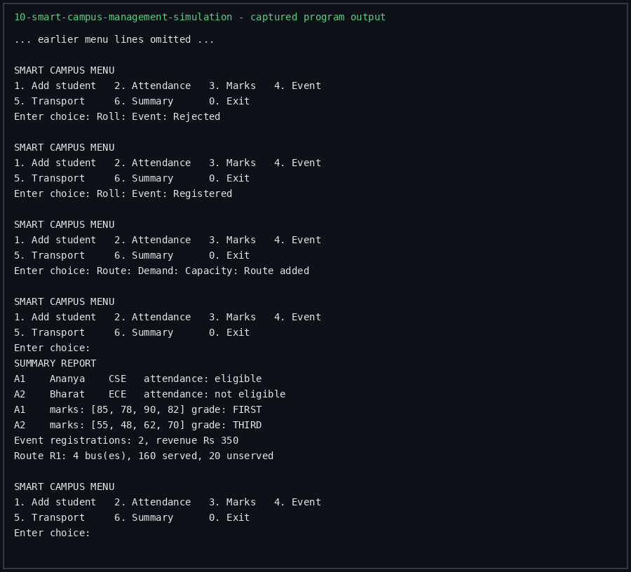

# Case Study 10 - Comprehensive Smart Campus Management Simulation

## Problem statement

Build a menu-driven program that manages student records, attendance, marks, event registration, transport allocation and a summary report.

## Objectives

Combine lists, nested lists, tuples and tuple unpacking in one program; validate each entry and print a consolidated report.

## Assumptions

Attendance eligibility is at least 75%. Grades: FIRST at 75, SECOND at 60, THIRD at 40, otherwise FAIL. Event fees are TechFest Rs 200 and Workshop Rs 150. Only fully filled buses are arranged, so leftover passengers remain unserved. Sample input is in demo_input.txt.

## Algorithm

1. Start with empty lists for students, attendance, marks, events and routes.
2. Display the menu and read the choice.
3. For add student, reject empty or duplicate roll numbers.
4. For attendance, validate present and total and store the record.
5. For marks, validate the range and store the list.
6. For event, check the roll number, event name and previous registration.
7. For transport, compute buses as demand divided by capacity.
8. For summary, print eligibility, grades, revenue and unserved passengers.
9. Repeat until choice 0, then stop.

## Flowchart



## Pseudocode

```
BEGIN SMART CAMPUS
  CREATE empty students, attendance, marks, events and routes lists
  REPEAT
    PRINT menu and READ choice
    IF choice = 1 THEN ADD student after duplicate check
    ELSE IF choice = 2 THEN ADD attendance after range check
    ELSE IF choice = 3 THEN ADD marks after range check
    ELSE IF choice = 4 THEN ADD event after fee and duplicate check
    ELSE IF choice = 5 THEN ADD route
    ELSE IF choice = 6 THEN PRINT summary
  UNTIL choice = 0
END
```

## Python source code

```python
"""
Case Study 10: Comprehensive Smart Campus Management Simulation
Menu-driven program using lists, nested lists, tuples and unpacking.
"""

EVENTS = (("TechFest", 200), ("Workshop", 150))
ATTENDANCE_LIMIT = 75.0


def add_student(students, roll, name, branch):
    if roll == "" or name == "":
        return False
    for record in students:
        if record[0] == roll:
            return False
    students.append([roll, name, branch])
    return True


def record_attendance(attendance, students, roll, present, total):
    if total <= 0 or present < 0 or present > total:
        return False
    found = False
    for record in students:
        if record[0] == roll:
            found = True
    if not found:
        return False
    attendance.append([roll, present, total])
    return True


def attendance_eligible(attendance, roll):
    for record in attendance:
        if record[0] == roll:
            percentage = record[1] * 100 / record[2]
            return percentage >= ATTENDANCE_LIMIT
    return False


def record_marks(marks_records, students, roll, marks):
    if len(marks) == 0:
        return False
    for mark in marks:
        if mark < 0 or mark > 100:
            return False
    found = False
    for record in students:
        if record[0] == roll:
            found = True
    if not found:
        return False
    marks_records.append([roll, marks])
    return True


def grade_for(marks):
    total = 0
    for mark in marks:
        total = total + mark
    average = total / len(marks)
    if average >= 75:
        return "FIRST"
    elif average >= 60:
        return "SECOND"
    elif average >= 40:
        return "THIRD"
    return "FAIL"


def register_event(events, students, roll, event_name):
    fee = -1
    for name, price in EVENTS:
        if name == event_name:
            fee = price
    if fee == -1:
        return False
    for record in students:
        if record[0] == roll:
            for old_roll, old_event, old_fee in events:
                if old_roll == roll and old_event == event_name:
                    return False
            events.append((roll, event_name, fee))
            return True
    return False


def allocate_transport(routes):
    result = []
    for route, demand, capacity in routes:
        buses = demand // capacity
        served = buses * capacity
        result.append((route, buses, served, demand - served))
    return result


def print_summary(students, attendance, marks_records, events, routes):
    print("\nSUMMARY REPORT")
    for roll, name, branch in students:
        status = "eligible" if attendance_eligible(attendance, roll) else "not eligible"
        print("%-5s %-9s %-5s attendance: %s" % (roll, name, branch, status))
    for roll, marks in marks_records:
        print("%-5s marks: %s grade: %s" %
              (roll, marks, grade_for(marks)))
    revenue = 0
    for roll, event_name, fee in events:
        revenue = revenue + fee
    print("Event registrations: %d, revenue Rs %d" % (len(events), revenue))
    for route, buses, served, unserved in allocate_transport(routes):
        print("Route %s: %d bus(es), %d served, %d unserved" %
              (route, buses, served, unserved))


def main():
    students = []
    attendance = []
    marks_records = []
    events = []
    routes = []
    while True:
        print("\nSMART CAMPUS MENU")
        print("1. Add student   2. Attendance   3. Marks   4. Event")
        print("5. Transport     6. Summary      0. Exit")
        choice = input("Enter choice: ")
        if choice == "1":
            roll = input("Roll: ")
            name = input("Name: ")
            branch = input("Branch: ")
            print("Added" if add_student(students, roll, name, branch) else "Rejected")
        elif choice == "2":
            roll = input("Roll: ")
            present = int(input("Present: "))
            total = int(input("Total: "))
            print("Recorded" if record_attendance(attendance, students, roll, present, total)
                  else "Rejected")
        elif choice == "3":
            roll = input("Roll: ")
            marks_text = input("Marks: ")
            parts = marks_text.split()
            marks = []
            for part in parts:
                marks.append(int(part))
            print("Recorded" if record_marks(marks_records, students, roll, marks)
                  else "Rejected")
        elif choice == "4":
            roll = input("Roll: ")
            event_name = input("Event: ")
            print("Registered" if register_event(events, students, roll, event_name)
                  else "Rejected")
        elif choice == "5":
            route = input("Route: ")
            demand = int(input("Demand: "))
            capacity = int(input("Capacity: "))
            routes.append((route, demand, capacity))
            print("Route added")
        elif choice == "6":
            print_summary(students, attendance, marks_records, events, routes)
        elif choice == "0":
            break
        else:
            print("Please choose a valid option.")


if __name__ == "__main__":
    main()
```

## Test cases

1. student A1 added - PASS
2. duplicate roll rejected - PASS
3. empty roll rejected - PASS
4. 18/20 is recorded - PASS
5. eligibility at 90 percent - PASS
6. eligibility at 65 percent - PASS
7. present greater than total rejected - PASS
8. marks recorded - PASS
9. average gives FIRST grade - PASS
10. average gives SECOND grade - PASS
11. mark above 100 rejected - PASS
12. TechFest registered - PASS
13. duplicate event rejected - PASS
14. unknown event rejected - PASS
15. R1 needs 4 buses - PASS
16. R1 serves 160 - PASS
17. R1 leaves 20 unserved - PASS
18. R2 needs 2 buses - PASS
19. R2 has no unserved passengers - PASS

19/19 tests passed. (see `test_cases.py`).

## Output screenshot



Captured output: `output.txt`.

## Conclusion

Every module updates only its own list, which keeps the menu program easy to follow. The summary combines all modules and reports the remaining demand.
